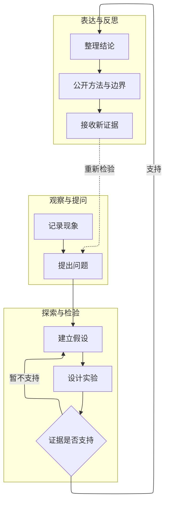
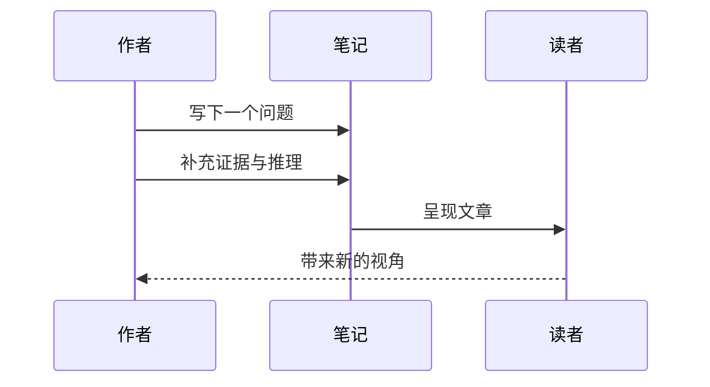

> [!note] 排版样稿
> 这里的每一段内容都可以在 Obsidian 中直接修改，用来验证你的写作习惯是否适合网页阅读。

文字是主体。图片、代码与图表的作用，是在需要的时候让表达更准确。

## 高清图片

下面是一张 3200 像素宽的测试图。正文按设备尺寸加载，点击图片可以查看高清版本。

![[Blog/Attachments/landscape.png|山峦与河流：高清图片展示样稿]]

图片说明可以直接写在下面。图片文件名、文章标题和正文均支持中文。

## 代码与可复现的过程

围栏代码块标明语言，网页会自动高亮。复制按钮保留代码原有的换行与缩进。

```python
from dataclasses import dataclass

@dataclass
class Observation:
    question: str
    evidence: list[str]

note = Observation(
    question="这个现象还可以怎样解释？",
    evidence=["先记录事实", "再检验假设"],
)
print(note.question)
```

## 数学公式

行内公式，例如 $E = mc^2$，可以自然地放进句子。更长的推导使用独立公式：

$$
P(H \mid D) = \frac{P(D \mid H)\,P(H)}{P(D)}
$$

矩阵、求和与积分也可以使用：

$$
\mathbf{A}=\begin{pmatrix}1 & 2 \\ 3 & 4\end{pmatrix},
\qquad
\int_0^1 x^2\,\mathrm{d}x=\frac{1}{3}
$$

## 复杂流程图

分组与反馈关系可以帮助读者理解完整过程。工具栏支持缩放、全屏与 SVG 下载。



### 时序图



## 引用、提示与脚注

> [!tip] 保持表达清晰
> 先说问题，再给证据，最后交代判断的适用范围。

> [!question]- 一个可以折叠的问题
> 这段文字演示 Obsidian 的可折叠 Callout。

一段引用与一个脚注，常常足以为读者提供继续探索的方向。[^note]

| 表达形式 | 适合的内容 |
| --- | --- |
| 文字 | 解释、叙述与论证 |
| 代码 | 可复现的具体过程 |
| 公式 | 精确定义与推导 |
| 图表 | 结构、关系与时间顺序 |

[^note]: 这是一条排版示例脚注。正式文章中可以替换为原始文献、补充解释或资料链接。
