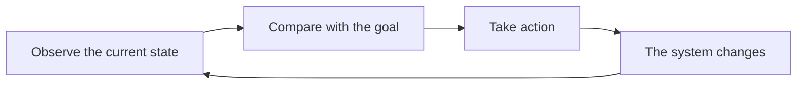

> [!info] A reading sample
> This article demonstrates long-form reading, the table of contents, and diagrams.

When we look at a forest, we readily notice its trees. To understand the forest, we also need to see their relationships: light, water, soil, competition, and cooperation.

## Beyond the parts

Taking a system apart is an important way to understand it. Once we have separated the parts, we also need to put their relationships back. The same elements, connected differently, can behave in very different ways.

A simple framework begins with three questions:

- What elements make up the system?
- How do information and resources move between them?
- Which changes return to influence their own starting point?

## How feedback shapes behavior

Feedback occurs when a result returns to influence what happens next. Reinforcing feedback amplifies change; balancing feedback tends to counter it.

### Remember the delay

There is often a delay between action and result. Repeating the same action while waiting can lead to overcorrection.

Consider adjusting the temperature of a shower. The water takes time to reflect a change at the valve. If we keep adjusting too quickly, the temperature may swing between hot and cold.

## Keep the boundaries visible

A model is a selective account of reality. When we draw its boundary, we also decide which relationships to leave outside the discussion for now.

> [!tip] A useful habit
> Write down where a model applies, and what it does not explain. When a new observation appears, check the boundary before revising the conclusion.

Drawing a relationship is often more useful than adding another term. The next time a problem keeps returning, try sketching its feedback loops first.
