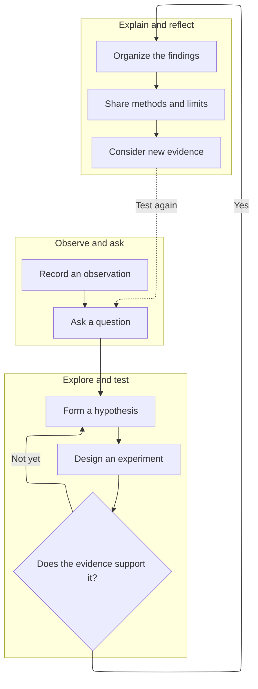
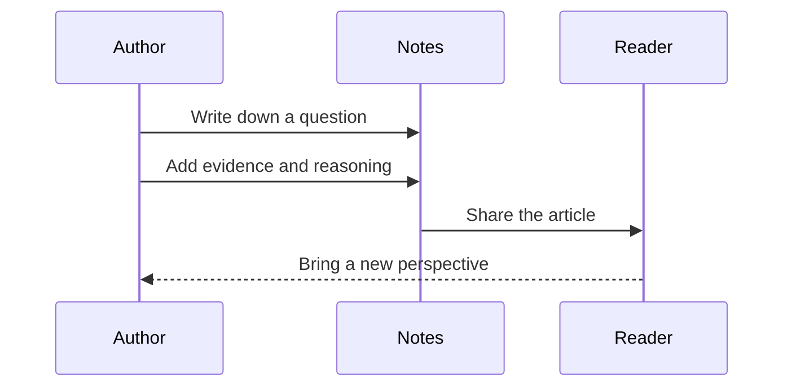

> [!note] A typography sample
> Every section can be edited in Obsidian to explore how your writing reads on the web.

Words come first. Images, code, and diagrams help make an explanation more precise when they are needed.

## High-resolution images

The image below is 3200 pixels wide. The article loads a size suited to your screen. Click it to open the high-resolution version.

![[Blog/Attachments/landscape.png|Mountains and a river: a high-resolution image sample]]

A caption can sit naturally beneath an image. Filenames and article content can use Chinese or English.

## Code and reproducible steps

Name the language after a code fence to enable syntax highlighting. The copy button preserves line breaks and indentation.

```python
from dataclasses import dataclass

@dataclass
class Observation:
    question: str
    evidence: list[str]

note = Observation(
    question="How else could we explain this observation?",
    evidence=["Record the facts", "Then test the hypothesis"],
)
print(note.question)
```

## Mathematical equations

An inline equation, such as $E = mc^2$, fits into a sentence. Use a display equation for a longer expression:

$$
P(H \mid D) = \frac{P(D \mid H)\,P(H)}{P(D)}
$$

Matrices, sums, and integrals are supported too:

$$
\mathbf{A}=\begin{pmatrix}1 & 2 \\ 3 & 4\end{pmatrix},
\qquad
\int_0^1 x^2\,\mathrm{d}x=\frac{1}{3}
$$

## More complex diagrams

Groups and feedback links help explain a complete process. The toolbar supports zooming, full screen, and SVG downloads.



### A sequence diagram



## Quotes, callouts, and notes

> [!tip] Keep the explanation clear
> Start with the question, present the evidence, and describe the limits of your conclusion.

> [!question]- A question you can unfold
> This demonstrates a collapsible Obsidian callout.

A quotation and a footnote can give a reader a useful starting point for further exploration.[^note]

| Format | Best suited to |
| --- | --- |
| Prose | Explanations, stories, and arguments |
| Code | Specific, reproducible steps |
| Equations | Precise definitions and derivations |
| Diagrams | Structure, relationships, and sequence |

[^note]: A sample footnote. In an article, replace it with a primary source, an explanation, or a reference link.
