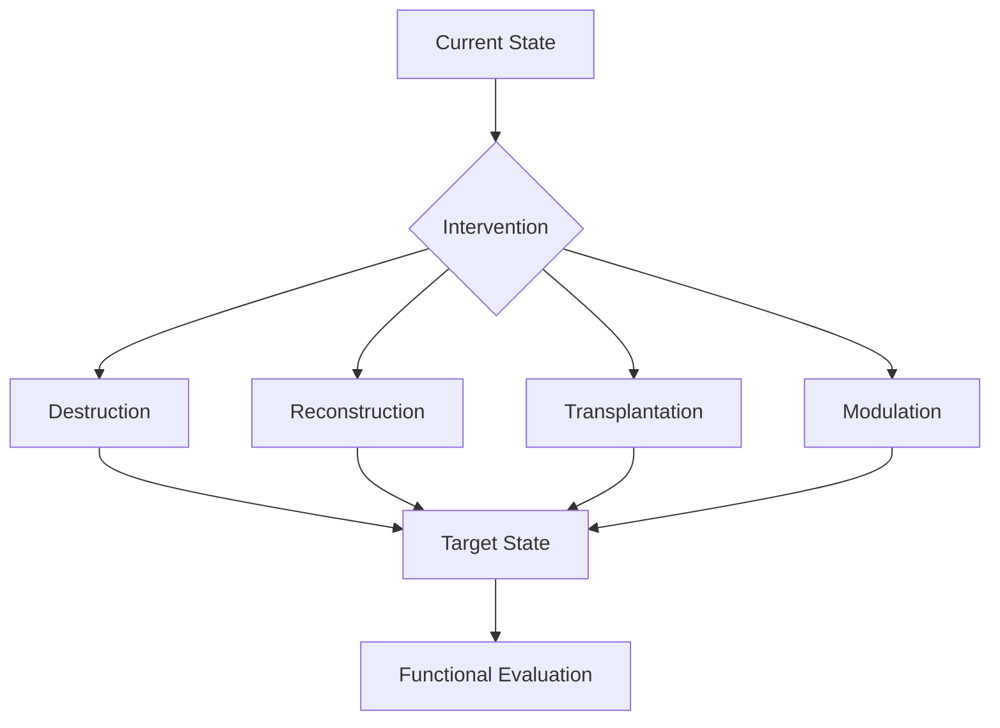

# Designing Surgical Robots and the Future of Surgery

*From miniature robots to the basic principles of surgical intervention*

Since beginning my PhD, I have kept thinking about a particular kind of surgical robot.

It would work in extremely confined spaces, perhaps entering the body through blood vessels and performing complex tissue operations inside the heart or other organs. Instead of the large arms of today’s da Vinci systems, imaging, localization, and actuation might be integrated into a millimeter-scale end system operated from outside the body.

> A little like piloting a submarine, haha.

The physician would no longer need to expose the surgical field directly. Sensors would reveal the environment inside the body, while remote controls enabled tissue manipulation.

Of course, such a system would be difficult to build. We would need to solve imaging in blood and bodily fluids, miniaturize actuators, and address tissue motion, operating forces, retrieval, biocompatibility, and many other problems.

But late tonight, rather than pushing myself to build it, I began wondering: **if we really had such robots one day, how would surgery itself change?**

## 01. The essence of surgery

Many medical treatments regulate internal states of living systems: changing protein activity, adjusting cellular metabolism, or controlling inflammation to restore physiological function.

Other problems require direct changes to the physical state of tissue or organs.

Examples include removing a tumor, repairing a damaged vessel, or replacing an organ that has lost its function.

I tend to group the fundamental tasks of traditional surgery into three categories:

**Destruction, reconstruction, and transplantation.**

> After discussing this with GPT, I will introduce a fourth basic operation below: modulation.

The procedures familiar to us today are, to a considerable extent, shaped by our instruments.

For vascular anastomosis, for example, our objectives are continuity, sealing, and unobstructed blood flow—not suturing for its own sake.

In open surgery, hands, needle holders, and thread naturally led to suturing and knot-tying techniques. Laparoscopy changed the working space and brought a proliferation of clips, staples, and energy-based sealing devices.

Why, then, should miniature robots still have to learn to thread a needle?

If tissues can be joined by mechanical interlocking, material cross-linking, or another physical mechanism, we need not retain the traditional operation.

**The fundamental tasks of surgery remain the same. The means by which we accomplish them change.**

## 02. Two boundaries of surgery

I see two main constraints:

1. **The epistemic boundary:** Do we know what should be changed?
2. **The operational boundary:** Can we make that change?

### 2.1 The epistemic boundary: scale of intervention

This touches on a question that has long interested me: scale in medicine.

The human body is a multiscale complex system. Molecules, cells, tissues, and organs each have different effective degrees of freedom.

There is a connection here to coarse-graining and the renormalization group (RG) in physics. After coarse-graining a microscopic system, its macroscopic behavior can often be described by a small number of effective variables, without tracking every microscopic degree of freedom. Of course, nonequilibrium dynamics in living systems are far more complicated than standard RG models.

My basic view is:

**Consider solving a problem at the scale where it is best addressed.**

This need not be the scale at which a disease originated. It is the disease’s current dominant control scale.

Take myocardial infarction. The initial problem may be coronary occlusion, but cell death, fibrosis, and ventricular remodeling can turn it into an organ-scale mechanical problem.

Restoring coronary perfusion does not necessarily restore ventricular geometry. Modulating a protein node might help, but changing the ventricle’s mechanical boundary conditions directly could also offer a more effective form of control.

This relates to how I understand disease itself.

I do not think there is an absolutely sharp physical boundary between normal and pathological states. Life is a nonequilibrium dynamical system. Some diseases can be understood as transitions into another relatively stable state, or even a new attractor, although not every pathological process has a stable attractor.

Treatment therefore need not reverse every step of disease development.

> Does this sound familiar to anyone who has studied control theory?
>
> Let the state of a living system be $x(t)$, and let intervention at scale $\ell$ be $u_\ell$. Conceptually, its dynamics can be written as:
>
> $\dot{x}(t)=f(x(t),u_\ell(t),t)$
>
> The question is how to choose $\ell$ and $u_\ell$ so the system reaches a desired state at reasonable risk and cost—in other words, how to find the most effective control input across scales.
>
> $(\ell^*,u^*)=\operatorname*{arg\,min}_{\ell,u}J(\ell,u)$
>
> Here $J$ combines therapeutic effectiveness, risk, time, and cost. This is fundamentally an optimal-control problem.

A disease’s etiology and the best intervention target need not coincide. Even a complete molecular explanation does not guarantee that we have found the most effective treatment.

Medicine is, ultimately, also engineering: solving problems.

### 2.2 The operational boundary: how to intervene?

Suppose we have established that a disease should be addressed at tissue scale. The next question is technological.

We may need to change tissue geometry, local stress, or tissue connections, or introduce a new functional material.

Traditional surgery requires adequate visibility and room to maneuver instruments. Highly customized miniature actuators, smart materials, and new tissue-joining techniques could instead allow us to design an operation directly around a target state.

The logic becomes:

**Current State → Target State → Physical Mechanism → Instrument Design**

Rather than first building a robot with many degrees of freedom and then searching for operations it can perform, we let the therapeutic objective determine the instrument’s design.

## 03. A fourth basic operation: modulation

Returning to destruction, reconstruction, and transplantation, my discussion with GPT suggested another operation worth considering separately.

After myocardial infarction, for example, a mechanical device might bring local wall stress closer to normal physiological conditions. We could call that reconstruction.

But what if restoring normality is not the objective?

Suppose we intentionally place some tissue in a nonphysiological mechanical state because doing so improves overall organ function. That is not quite restorative reconstruction.

The local state need not return to normal. It might deliberately depart from normal, provided overall function improves. **The point is to achieve the medical objective.**

There is no contradiction here for a complex system: a local optimum need not be the global optimum.

For now, I call this intervention modulation.

| Basic operation | Purpose                                                       |
| --------------- | ------------------------------------------------------------- |
| Destruction     | Remove or disrupt existing structures                         |
| Reconstruction  | Restore or reorganize structure and physical state            |
| Transplantation | Introduce tissue, material, or a functional unit              |
| Modulation      | Change local operating conditions to improve overall function |

This is not a strict classification. The first three mainly describe changes in material and structure, while modulation emphasizes intervention in system dynamics. It may be accomplished through the other three operations.

Still, it deserves separate attention because it suggests a different surgical approach: **we need not always restore the body’s original state; we can deliberately design a new state that supports better system function.**

### Figure 2. Basic surgical operations and target states

These four operations can be combined and need not be mutually exclusive. The purpose is not to label every procedure, but to separate a named procedure from the intervention task it actually accomplishes.

> Obsidian’s built-in Mermaid diagrams really are ugly.

## 04. The future of surgery

Return to the miniature robot with which we began.

If we can identify a disease’s current dominant control scale, and act precisely at that scale, surgery need not be confined to existing procedures.

In mitral regurgitation, for example, the problem may lie in annular geometry, chordal connections, or leaflet stress. It does not necessarily demand a particular established mitral valve repair.

Future surgery could be defined directly as a combination of interventions that achieve an objective: destruction, reconstruction, transplantation, and modulation.

This may be the conceptual shift: **our understanding of living systems determines the scale at which we should intervene, while new technologies determine what we can do at that scale.**

Whether the final instrument is a scalpel, a suture, or a miniature robot working inside a vessel is, in the end, secondary.
