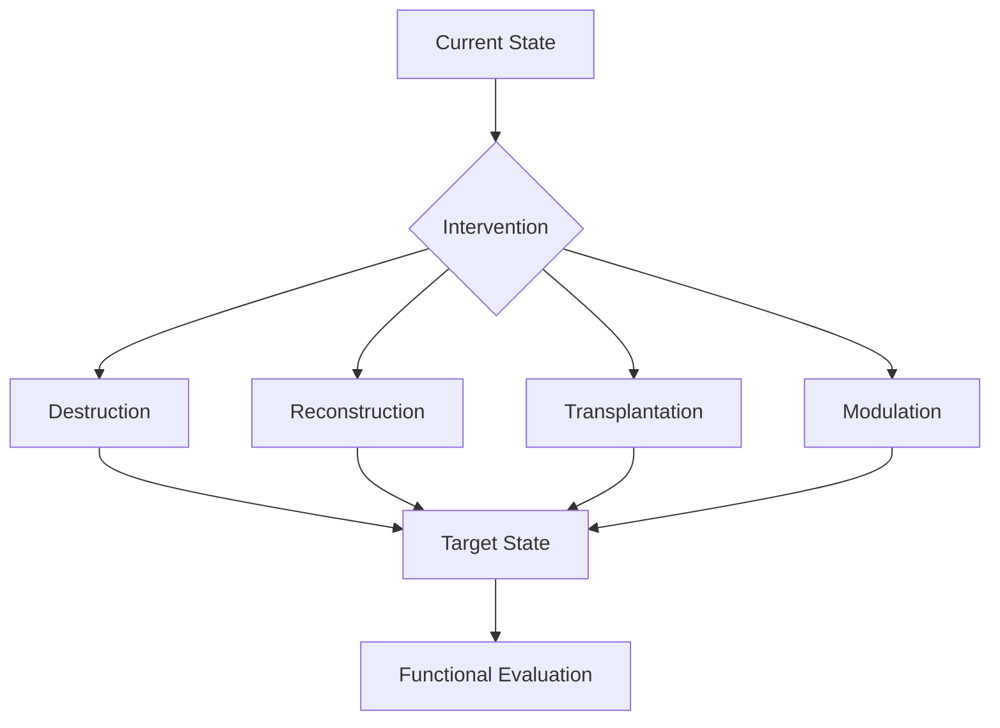

# 手术机器人的设计与外科的未来

*从微型机器人到外科干预的基本原理*

从我开始读博士开始，一直在思考一种手术机器人。

它可以在极端狭小的空间内工作，甚至能够通过血管进入人体，在心脏或者其他器官内部完成复杂的组织操作。它可能不再具有今天达芬奇手术机器人那样庞大的机械臂，而是将成像、定位和执行机构集成到一个毫米尺度的末端系统中，通过体外的主控设备进行操作。

> 这有点像驾驶一艘潜艇哈哈哈

医生不再需要直接暴露手术区域，而是通过传感器感知人体内部的环境，通过远程控制系统完成组织操作。

当然，实现这样的系统并不容易。我们需要解决血液和体液环境中的成像问题，需要把执行器缩小到足够小的尺寸，还要解决组织运动、操作力、器械回收以及生物相容性等一系列问题。

但现在大半夜的，我倒不是想push自己把它做出来，而是开始思考，**假如有一天，我们真的拥有了这样的机器人，那么外科本身会发生怎样的变化？**

## 01. 外科的本质

现代医学中的大量治疗，本质上是对生命系统内部状态的调控。例如，通过药物改变某种蛋白质的活性、调节细胞代谢、控制炎症反应，最终恢复某种生理功能。

但还有一些问题，必须通过直接改变组织或器官的物理状态来解决。

例如，切除一块肿瘤、修复一段破损的血管，或者替换一个失去功能的器官。

我倾向于将传统外科的基本任务归纳为三个部分：

**破坏（Destruction）、重建（Reconstruction）和移植（Transplantation）。**

> 和GPT聊了之后，在后文会加入一种新的基本单元：Modulation。

而我们今天熟悉的术式，其实很大程度上取决于器械。

比如血管吻合，我们的目的是恢复血管的连续性（Continuity）、密封性（Sealing）和血流通畅，而不是缝合本身。

开放外科时代，我们使用双手、持针器和缝线，自然发展出了缝合、打结等技术。到了腔镜时代，操作空间改变了，于是出现了大量夹闭、钉合及能量封闭装置。

那么进入微型机器人时代，我们为什么还要让机器人学习穿针引线？

如果组织连接能够通过机械扣合、材料交联或者其他物理机制完成，我们就没有必要继续使用传统的操作方法。

**外科的基本任务没有改变，改变的是我们实现这些任务的手段。**

## 02. 外科的两个边界

我认为外科主要受到两个方面的限制：

1. **认识边界（Epistemic Boundary）**：我们是否知道应该改变什么？

2. **操作边界（Operational Boundary）**：我们是否有能力实现这种改变？

### 2.1 认识边界：Scale of Intervention

这里涉及一个我一直比较感兴趣的问题：医学中的 Scale。

人体是一个多尺度复杂系统。从分子、细胞到组织、器官，不同尺度具有不同的 Effective Degrees of Freedom。

这与物理学中的 Coarse-graining 和 Renormalization Group（RG）有一定联系。微观系统经过粗粒化后，其宏观行为往往可以由少数有效变量描述，而不必追踪所有微观自由度。当然，生命系统的非平衡动力学远比标准 RG 模型复杂。

我的一个基本观点是：

**什么尺度的问题，优先考虑在什么尺度上解决。**

不过，这里的尺度并不是疾病的起源尺度，而是它当前的主导控制尺度（Dominant Control Scale）。

以心肌梗死为例。最初的问题可能是冠状动脉闭塞，但经过细胞死亡、纤维化以及心室重构，疾病可能已经演化为一个器官尺度的力学问题。

此时即使恢复冠状动脉灌注，也不意味着心室几何能够自行恢复。调控某个蛋白质节点可能有帮助，但直接改变心室的力学边界条件，也可能是更有效的控制方式。

这涉及我对疾病本身的一些理解。

我不认为正常和病理之间具有绝对明确的物理边界。生命是一个非平衡动力系统，某些疾病可以理解为系统从原有状态演化到了另一个相对稳定的状态，甚至形成新的 Attractor。当然，并非所有病理过程都存在稳定吸引子。

既然如此，治疗未必需要逆转疾病发生的全部过程。

> 换个表达方式，学过控制论的有没有熟悉的感觉：
>
> 设生命系统的状态为 x(t)，尺度 ℓ 上的干预为 uₗ，那么其动力学可以概念性地写为：
>
> **ẋ(t) = f(x(t), uₗ(t), t)**
>
> 我们关心的是，如何选择 ℓ 和 uₗ，使系统以合理的风险和代价演化到期望状态。也就是在不同尺度上寻找最有效的控制输入。
>
> **(ℓ*, u*) = arg min J(ℓ, u)\*\*
>
> 这里 J 表示综合治疗效果、风险、时间和代价的目标函数。这本质上是一个 Optimal Control 问题。

疾病的Etiology和最佳干预靶点并不一定相同。即使完整解释了某个疾病的分子机制，也不代表我们找到了最有效的治疗方式。

医学的本质还是工程学，解决问题。

### 2.2 操作边界：How to Intervene?

假设我们已经确定某个疾病应该在组织尺度上干预，那么接下来就是技术问题。

我们要改变一块组织的几何形态、局部应力、组织连接，或者引入新的功能性材料。

在传统外科中，这些操作需要足够的视野和器械活动空间。但如果未来有了高度定制化的微型执行器、智能材料以及新的组织连接技术，我们就可以直接根据 Target State 设计操作。

整个逻辑可以概括为：

**Current State → Target State → Physical Mechanism → Instrument Design**

而不是先设计一台具有复杂自由度的机器人，再寻找它能完成哪些手术。

这里，器械的设计是由治疗目标决定的。

## 03. 第四种基本操作：Modulation

回到前面提到的 Destruction、Reconstruction 和 Transplantation。

和GPT讨论时发现，还有一种操作可能需要单独考虑。

例如，心肌梗死后，我们通过某种机械装置改变局部壁应力，使其接近正常生理状态。这可以理解为 Reconstruction。

但如果我们的目的并不是恢复正常呢？

假设我们主动让一部分组织处于某种非生理的机械状态，却能够改善器官整体功能，那么这种操作就不完全属于恢复性重建。

也就是说，局部状态不需要回到正常，甚至可以主动偏离正常，只要最终能够改善整体功能。**达到医学目的就可以了。**

这在复杂系统中并不矛盾，Local Optimum 不一定对应 Global Optimum。

我暂时把这种干预称为 Modulation。

| 基本操作            | 目的              |
| --------------- | --------------- |
| Destruction     | 去除或破坏现有结构       |
| Reconstruction  | 恢复或重组结构与物理状态    |
| Transplantation | 引入新的组织、材料或功能单元  |
| Modulation      | 改变局部运行条件，优化整体功能 |

当然，这个分类并不严格。前三种主要描述物质和结构变化，而 Modulation 更强调对系统动力学的干预。它可能通过前面三种手段实现。

但我觉得值得单独提出，因为它引出了另一种外科思路：**我们不一定要恢复人体原有的状态，也可以主动设计一种新的、更有利于系统运行的状态。**

### 图 2. 外科的基本操作与目标状态

这四种操作可以组合使用，也不一定互斥。分类的目的不是给每一种手术贴标签，而是把具体术式与它实际要完成的干预任务分开。

> obsidian自带的mermaid绘图是真的丑

## 04. 外科的未来

回到最开始的微型机器人。

如果我们能够明确疾病当前的 Dominant Control Scale，又拥有在这个尺度上进行精确操作的能力，那么外科就不必局限于现有术式。

比如二尖瓣反流，我们需要解决的可能是瓣环几何、腱索连接或者瓣叶应力，而不是一定要完成某一种既定的二尖瓣成形术。

未来外科可以直接定义 为达到目的之干预的组合， 可以是 Destruction、Reconstruction、Transplantation、Modulation。

我觉得理解的改变可能就发生在这里：**一方面，我们对生命系统的理解决定应该在什么尺度上干预；另一方面，新的技术决定我们能够在这个尺度上做什么。**

至于最后用的是手术刀、缝线，还是一台能够在血管里工作的微型机器人，其实不重要。
